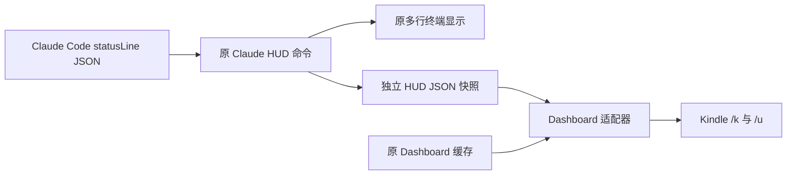

# Claude HUD 本地兼容说明

版本：v1.2

更新日期：2026-10-20

## 最终方案

优先使用 P0：Claude HUD 通过原生 `display.externalUsageWritePath` 写出独立快照，Dashboard 直接读取快照。Claude Code 继续执行原 HUD 命令，不启用 Fanout，不修改 HUD 插件源码、显示布局或其他显示选项。P1 作为未启用的兼容备选保留。



本项目仅读取已有额度事件，不增加 OAuth 查询。快照时间是本地写入时间，不代表账户额度刚被重新查询。两个来源只适合用于同一账户；切换账户或配置目录时应使用独立快照路径，避免将不同账户的数据按时间比较。

## P0 配置

1. 查看 Claude Code 当前生效的 `statusLine.command`，核对其实际调用的插件目录及 `CLAUDE_CONFIG_DIR`。如仍经过旧 Bridge，先保存完整命令，在快照链路验证后恢复为已保存的 HUD 原命令。不要猜测插件安装路径，不自动升级插件。
2. 备份 Claude settings、实际 HUD 配置及本地项目配置。合并配置时保留所有原有字段。
3. 在 HUD 配置的 `display` 中设置 `externalUsageWritePath`，指向已有目录下的独立 `.json` 文件，使用展开后的绝对路径。本机核查的 `0.2.0` 实现不展开 `~`。
4. 在项目 `config.json` 中设置 `claudeHudUsagePath`，值为同一个绝对路径。该文件已被 Git 忽略，不提交个人路径。
5. 在 Claude Code 使用一次真实会话，使原 HUD 接收到有效 `rate_limits`。检查快照及权限；运行或重新启动 Dashboard，访问 `/api/usage`、`/k`、`/u`。

`CLAUDE_HUD_USAGE_PATH` 优先于本地配置，显式空字符串禁用 HUD 数据源。`CLAUDE_USAGE_CACHE` 的路径覆盖规则保持不变。没有配置 HUD 数据源时，有效旧缓存的读取方式不变；损坏的旧数据也会经过合法性验证。

项目本地配置在服务启动时加载；无论终端启动还是原自启动脚本，都会读取同一项目目录内的 `config.json`。修改配置后需要重启当前服务，避免重复启动而占用 8787。

## 数据契约

实现依据：[Claude HUD 快照导出源码](https://github.com/jarrodwatts/claude-hud/blob/main/src/external-usage.ts)。实际运行能力以本机已安装的 `dist` 为准。

| 项目 | 规则 |
| --- | --- |
| HUD 时间 | `updated_at` 为带显式时区的 ISO 字符串，转换为毫秒 |
| 旧缓存时间 | `fetchedAt` 为 Unix 毫秒；旧窗口 `resets_at` 为 Unix 秒 |
| 百分比 | 必须为有限数值，范围包含 0 和 100；不接受字符串或布尔值 |
| 重置时间 | 缺失或 null 允许展示额度；非空但非法时，丢弃对应窗口 |
| 数据源有效性 | 数据时间有效，且至少一个窗口有效 |
| 未来时间 | 最多容忍本机时间之后 5 分钟，超过则拒绝该来源 |
| 陈旧数据 | 保留原始时间及额度，页面显示年龄，不伪造当前更新时间 |
| 选择顺序 | 按整份快照时间取较新来源，同时间优先 HUD |
| 部分窗口 | 保留 null，不用另一来源的旧窗口补齐 |
| 文件损坏 | 只读回退；不删除、覆盖、修复任何来源文件 |
| 精度 | 适配器不再次取整；HUD 自身可能先取整，例如 84.6→85、99.6→100 |
| 告警 | 使用选中来源提供的已用值比较阈值，不还原 HUD 已丢失的小数精度 |

## P1 兼容备选

本机 P0 可用时不启用 P1。备选安装入口：

```bash
node setup-statusline.js --fanout --plan-only
node setup-statusline.js --fanout
```

安装器遵循 `CLAUDE_CONFIG_DIR`，保留完整原命令和状态栏其他属性，备份失败即停止。已是本项目包装时复用保存的原命令，不创建多层包装；发现已知 Bridge 时拒绝自动包装，要求先核对原命令。运行时通过继承给子进程的深度标记阻断未知包装脚本的间接递归。

Dashboard 采集和 HUD 并行执行，各限制 2 秒，整体等待约为该预算及进程清理开销之和。每个子进程 stdout 与 stderr 合计最多 256 KiB；stdin 最多 256 KiB。HUD 成功且输出非空时原样返回其 stdout；否则使用成功的 Dashboard 输出，再否则返回 `Claude`。只使用 `trim()` 判空，保留原输出的所有换行、ANSI 颜色、Unicode、缩进。stderr 不进入状态栏。

macOS 超时及超量输出会终止该子进程组，包括 shell 后代；Windows 使用 `taskkill /T /F` 分支，此分支未在本机实测。独立进程组清理不覆盖主动创建全新会话的第三方程序。

备选缓存写入采用同目录唯一临时文件和原子替换，权限 `0600`。多会话不会写出半个 JSON；并发时以最后成功替换的快照为准，不保证代表最新服务端采样。输入不含服务端采样序号，不能据此承诺按官方采样顺序排序。无有效额度时不覆盖旧缓存。

## 验证与验收

```bash
npm test
npm run test:hud
```

`npm test` 使用临时合成数据，验证数据适配、故障回退、实际 HTTP 路由、持久配置、Fanout 输出与进程清理、24 路并发缓存写入、安装及回滚。HTTP 测试需要允许本机回环端口监听。测试不访问真实凭证、不发起账户额度查询。

`npm run test:hud` 使用本机安装记录定位 HUD，调用其实际 `dist` 和渲染器；使用合成模型、上下文、工具、Agent、Todo 数据，将导出前后的 stdout 逐字节比较，再检查导出失败不影响显示、`0600` 快照、取整边界、Dashboard 读取及 `/k`、`/u` 换算。写入只发生在临时目录。该检查不等于真实账户事件或 Kindle 真机验收。

真实验收需要分别核实：真实 Claude Code 事件生成快照并更新时间；终端 HUD 原显示正常；Dashboard 与同一快照值一致；Kindle 四项额度和时间仍可一屏显示。不得用合成数据冒充真实账户更新，不把快照写入时间当作官方观察时间。

本轮已执行的验证：

| 检查 | 结果 |
| --- | --- |
| `npm test` | 71 项通过，0 失败、0 跳过 |
| `npm run test:hud` | 本机实际 HUD `0.2.0` 的渲染及独立导出链路通过 |
| 真实 HUD 快照 | 已自然生成，有效，权限 `0600` |
| 真实 8787 服务 | `/api/usage`、`/k`、`/u` 与同一 HUD 快照一致，Codex 两个窗口有效 |
| 配置保持 | P0 启用前后的 `settings.json` 哈希一致，原显示选项保留 |
| Kindle 布局与 Codex 采集代码 | 与实施前备份逐段比较一致 |
| 真实服务浏览器渲染 | 禁用 JavaScript，4 种视口、2 个路由，共 8 项通过，无溢出 |
| 用户展示确认 | 用户已发送真实消息，并反馈可以展示；最新 HUD 快照与实际接口再次核对一致，四个额度窗口均有效 |
| 测试进程 | 本轮启动的 Dashboard 测试服务已停止，8787 端口已释放 |

浏览器视口覆盖 758×850、600×600、360×480、1024×650；600×600 下完整内容高约 500 像素。Windows 进程清理分支未在 macOS 测试中执行，不计入已验证结论。

## 回滚

本轮私有备份位于用户 Claude 配置目录的 `dashboard-backups` 下，具体目录由交付说明提供，包含原配置和修改前的项目文件。`settings.json` 不由 P0 修改，因此不需要恢复它，更不应覆盖之后对 HUD 命令的调整。

仅取消 P0 配置：

```bash
python3 scripts/rollback-local.py "$HOME/.claude/dashboard-backups/<本轮备份目录>"
```

脚本只移除本轮增加的两个路径字段，保留其他配置和后续修改。如果字段已改为其他路径，停止自动回滚。生成的 HUD 快照与旧缓存保留；重启 Dashboard 后使用原缓存。

若原 `usage-cache.json` 已由其他操作移除，回滚配置不会自动重建它。可以从本轮备份以“不覆盖已有文件”的方式恢复，或重新配置旧采集入口后等待真实会话更新。恢复备份时保留原 `fetchedAt`，不得当作新采样：

```bash
cp -n "$HOME/.claude/dashboard-backups/<本轮备份目录>/usage-cache.json" "$HOME/.claude/usage-cache.json"
```

恢复本轮全部代码，同时保留本轮之前已有的 Kindle 布局：

```bash
python3 scripts/rollback-local.py "$HOME/.claude/dashboard-backups/<本轮备份目录>" --all
```

完整回滚使用交付时的文件哈希预检查，存在后续改动时拒绝覆盖。代码恢复到本轮实施前的备份，而不是使用 `git reset`；不会丢弃此前 Kindle 布局修改。执行前退出该 Dashboard 服务，执行后再启动。

本地提交后执行此脚本会产生反向的工作区修改，不会自动删除或撤销 Git 提交；应检查差异后再决定是否提交回滚。

如果将来手动启用 P1，使用其安装器输出的专属备份目录恢复：

```bash
node setup-statusline.js --restore /absolute/path/to/statusline-backup
```

P1 回滚只恢复其管理的状态栏与额外命令字段，不覆盖其他设置；若管理字段已改变则停止。

## 上游关系

[Issue #3](https://github.com/frankchiu-dev/claude-codex-usage-dashboard/issues/3) 描述通用 Fanout 丢弃原显示输出的问题。P0 避开该包装层，P1 是本地备选修复。本轮修改按功能拆分为本地提交，不推送，不修改远端 Issue 或创建 PR。上游修复后可对照本地测试迁移 P1；P0 无需因此切回 Fanout。后续插件升级应重新执行本机 HUD 集成检查。

## 更新历史

- v1.2，2026-10-20：记录测试服务停止，按功能拆分本地提交，补充提交后的回滚行为。
- v1.1，2026-10-20：补齐用户发送真实消息后的展示确认及最新快照与接口核对结果。
- v1.0，2026-10-20：增加 P0 快照适配、P1 兼容备选、故障与并发测试、配置备份和字段级回滚说明。
